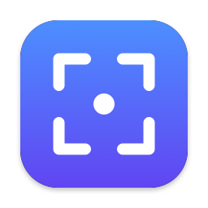
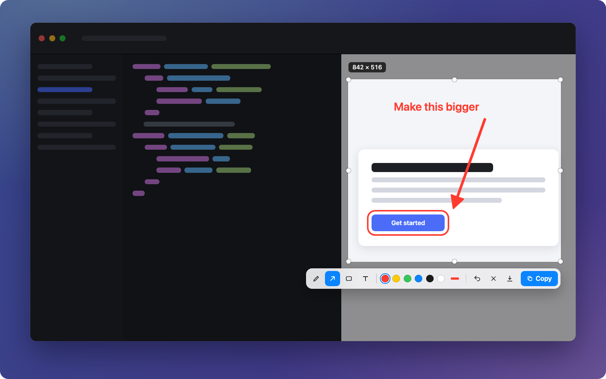

<div align="center">



# ShotMate: Free Screenshot Tool for Mac

**Hotkey → Select → Mark up → ⌘V.** A tiny, native macOS screenshot app that copies annotated screenshots straight to your clipboard.

[](https://github.com/shimentosh/ShotMate/releases/latest/download/ShotMate.dmg)

[](https://github.com/shimentosh/ShotMate/releases/latest)
[](#install)
[](#install)
[](LICENSE)
[](https://github.com/shimentosh/ShotMate/actions/workflows/build.yml)

[**Website**](https://shimentosh.github.io/ShotMate/) · [**Download**](https://github.com/shimentosh/ShotMate/releases/latest) · [**Report a bug**](https://github.com/shimentosh/ShotMate/issues)



</div>

---

ShotMate is a **free and open-source screenshot app for macOS**. Press a hotkey, drag over any part of the screen, add an arrow, a box or a note, and press Enter. The annotated screenshot is now on your clipboard, ready to paste into Slack, VS Code, ChatGPT, Notion, Mail, Messages, Discord or your browser with **⌘V**.

It lives in the menu bar, uses under 1 MB on disk, never uploads anything and has no settings you don't need. If you've used **Lightshot** or the built-in **⇧⌘4**, ShotMate is that same flow with markup tools and an instant copy.

## Features

- ⚡ **Instant capture**: one global shortcut (default **⇧⌘S**) freezes the screen immediately.
- 🖱️ **Precise selection**: drag to select, then move, resize with handles or nudge with arrow keys. Live size readout.
- ✏️ **Simple annotations**: pen, arrow, rectangle and text, with 6 colors and 3 thicknesses.
- 📋 **Copy to clipboard**: press Enter and paste anywhere. No intermediate file.
- 💾 **Save as PNG** (optional): native save dialog that remembers your last folder, or automatic saving.
- 🖥️ **Multi-monitor and Retina**: captures at native pixel density on every display, with no blur or offset.
- ⌨️ **Custom shortcut**: change it in one click. ShotMate detects conflicts with macOS and other apps.
- 🔒 **Private by design**: no account, network, analytics or cloud. Screenshots never leave your Mac.
- 🪶 **Native and lightweight**: Swift, AppKit and SwiftUI with ScreenCaptureKit. No third-party dependencies.

## Install

1. **[Download ShotMate.dmg](https://github.com/shimentosh/ShotMate/releases/latest/download/ShotMate.dmg)**, open it and drag **ShotMate** into **Applications**.
2. Open ShotMate. If macOS says it can't verify the app, go to **System Settings › Privacy & Security**, scroll down and click **Open Anyway**. You only need to do this once.
3. When asked, turn on **Screen Recording** for ShotMate, then reopen it.
4. Press **⇧⌘S** and take your first screenshot.

**Requirements:** macOS 14 Sonoma or later, Apple Silicon or Intel.

> ShotMate isn't notarized by Apple yet, which is why macOS asks you to confirm the first launch. You can also [build it yourself](#build-from-source) from the source code.

## How to use

| Action | Shortcut |
| --- | --- |
| Start a capture | **⇧⌘S** (customizable) or menu bar icon › Capture Screenshot |
| Select an area | Drag. Click without dragging to capture the whole display. |
| Move / resize the selection | Drag inside it / drag an edge or handle. **← → ↑ ↓** nudge (⇧ for 10 pt). |
| Pen · Arrow · Rectangle · Text | **P** · **A** · **R** · **T** (press again to switch back to move) |
| Undo | **⌘Z** |
| Copy & finish | **Enter**, or double-click the selection. **⌘C** always copies. |
| Save as PNG | **⌘S** |
| Cancel | **Esc** |

After copying, ShotMate returns you to the app you were using, so **⌘V** works immediately.

### Settings

Click the ShotMate icon in the menu bar:

- **Shortcut**: click *Change Shortcut* and press any combination. Shortcuts that would break typing (like ⇧A) or standard commands (like ⌘C) are rejected. Combinations macOS already uses (like ⇧⌘4) show a warning. F1–F20 work on their own.
- **After Capture**: *Copy to Clipboard* (default), *Save to File* or *Copy + Save*.
- **Launch at Login**: on by default.

## FAQ

<details>
<summary><b>Is ShotMate free?</b></summary>

Yes. ShotMate is free and open source under the [MIT license](LICENSE), with no account, subscription or ads.
</details>

<details>
<summary><b>Is ShotMate a good Lightshot alternative for Mac?</b></summary>

Yes. It keeps Lightshot's select, mark and copy simplicity, but it's a native macOS app with Retina-sharp captures, multi-monitor support, a customizable global hotkey and no cloud upload.
</details>

<details>
<summary><b>How do I copy a screenshot to the clipboard on Mac?</b></summary>

With ShotMate, press ⇧⌘S, select an area and press Enter. The screenshot (including your annotations) goes straight to the clipboard as an image. macOS's built-in way is ⌃⇧⌘4, but it has no annotation step.
</details>

<details>
<summary><b>Does ShotMate upload or collect my screenshots?</b></summary>

No. ShotMate has no network code at all. Screenshots go only to your clipboard, or to a folder you choose.
</details>

<details>
<summary><b>Why does ShotMate need Screen Recording permission?</b></summary>

macOS requires this permission for any app that captures the screen. Without it, ShotMate can only see your wallpaper. The capture happens entirely on your Mac.
</details>

<details>
<summary><b>Can I use Fn in the shortcut?</b></summary>

No. The macOS global hot key API doesn't support the Fn/🌐 key. You can use ⌘, ⌥, ⌃ and ⇧ with any key, or a function key (F1–F20) on its own.
</details>

## Build from source

Requires Xcode 16+ or the Swift 5.10+ Command Line Tools.

```sh
git clone https://github.com/shimentosh/ShotMate.git
cd ShotMate
Scripts/build-app.sh     # → build/ShotMate.app (universal, ad-hoc signed)
Scripts/build-dmg.sh     # → build/ShotMate.dmg
open build/ShotMate.app
```

You can also open `Package.swift` in Xcode and press **Run**.

With ad-hoc signing, macOS treats each rebuild as a new app, so Screen Recording permission has to be granted again. To avoid that, sign with a stable identity:
`SHOTMATE_SIGN_IDENTITY="Apple Development: …" Scripts/build-app.sh`.

### Releasing

Push a version tag and GitHub Actions builds a universal DMG and attaches it to a GitHub Release:

```sh
git tag v1.0.1 && git push origin v1.0.1
```

### Project structure

| Folder | Responsibility |
| --- | --- |
| `App/` | Entry point and app delegate (menu bar–only accessory app) |
| `Hotkey/` | Global shortcut via Carbon `RegisterEventHotKey`, recorder and conflict checks |
| `Capture/` | ScreenCaptureKit capture, per-display overlay, selection, toolbar, renderer |
| `Annotation/` | Pen, arrow, rectangle and text tools and the drawing canvas |
| `Clipboard/` | Pasteboard (PNG with on-demand TIFF) and PNG saving |
| `MenuBar/`, `Settings/` | SwiftUI popover, settings and Launch at Login (`SMAppService`) |
| `docs/` | The [website](https://shimentosh.github.io/ShotMate/) (GitHub Pages) |

## Contributing

Bug reports and pull requests are welcome. Please [open an issue](https://github.com/shimentosh/ShotMate/issues) first for larger changes. ShotMate is intentionally small, so new features should keep the hotkey → select → mark → copy flow fast and simple.

## License

[MIT](LICENSE) © shimentosh

<sub>Keywords: mac screenshot tool, screenshot app for macOS, Lightshot alternative for Mac, screenshot annotation, copy screenshot to clipboard, menu bar screenshot utility, free open-source screen capture.</sub>
